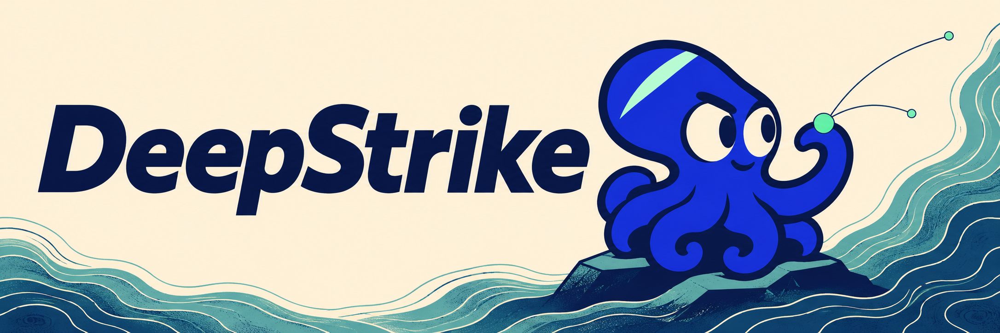
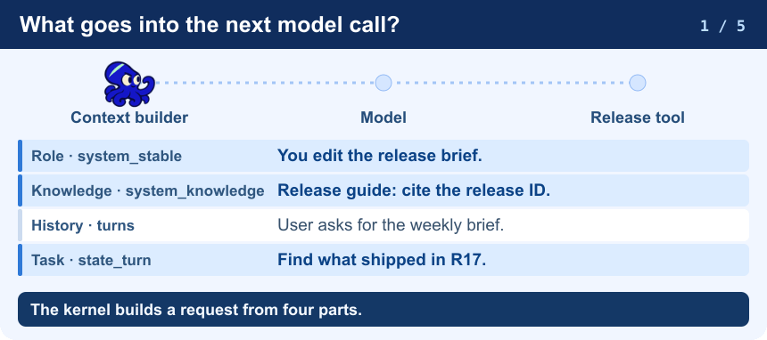
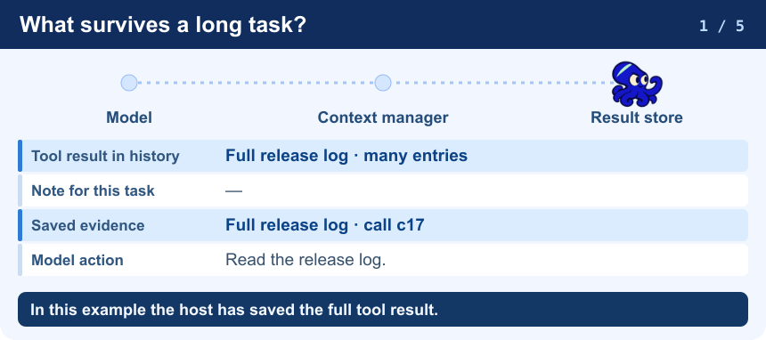
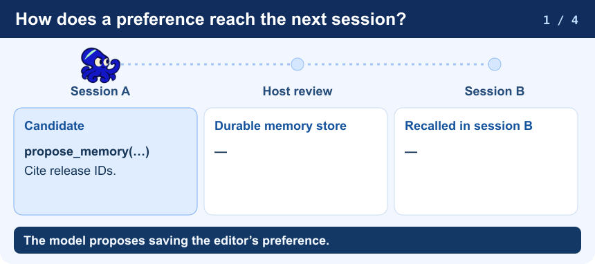
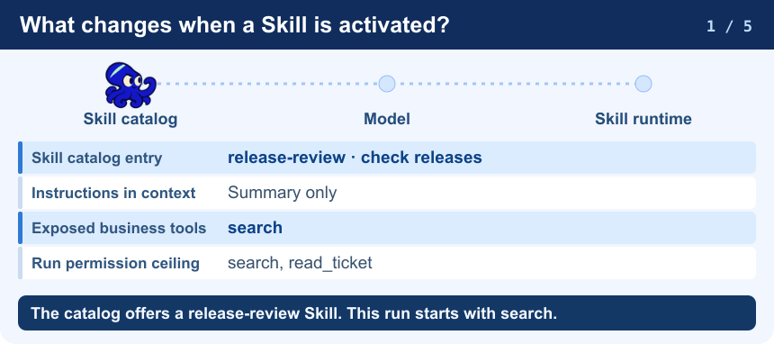

# DeepStrike

[中文](./README.zh-CN.md) · [SDKs](#run-your-first-agent) · [Examples](./example/README.md) · [Documentation](./docs/en/index.md) · [Discord](https://discord.gg/cwS3RBYCv)



<p align="center">
  <a href="https://github.com/kongusen/deepstrike/releases"></a>
  <a href="https://www.npmjs.com/package/@deepstrike/sdk"></a>
  <a href="https://pypi.org/project/deepstrike/"></a>
  <a href="https://crates.io/crates/deepstrike-sdk"></a>
  <a href="https://discord.gg/cwS3RBYCv"></a>
  <a href="./LICENSE"></a>
</p>

DeepStrike is an SDK for building AI assistants. You supply the model and tools. **DeepStrike assembles what the model sees on each step and determines which tools it can call.** The model can keep a finding in a task note, propose a preference to remember next time, or load a Skill when it needs a particular set of instructions.

## How a brief gets written

Imagine an assistant that reads release notes and support tickets to write a weekly brief. Follow the blue octopus to see how it checks a fact, keeps its place as sources pile up, recalls an editor’s preference next week, and follows the team’s review procedure.

### 1. What does the model see after a tool runs?

The user asks what shipped in R17. On its first call the model knows the task and asks for the release record. On its next call, DeepStrike gives it **the tool call paired with its result**. Now it has evidence to answer “offline search.” The kernel assembles each request from four parts. Watch the role and resident knowledge stay in place while the history changes and the current task stays in view.



[Execution model](./docs/en/architecture/execution-model.md) · [How context is assembled](./docs/en/guides/context-engineering.md)

### 2. What stays when the release log gets too long?

The model finds the ship date and calls `note` to keep “R17 shipped on May 8” in **this task’s notes**. As input space runs low, the kernel can shorten an older tool result while keeping the note in view. In this example the application saved the full log. When the model needs the exact wording, it can fetch the source with `read_result(call_id="c17")`.



[Context guide](./docs/en/guides/context-engineering.md) · [Task note design](./docs/en/decisions/013-model-led-context.md)

### 3. How does the next session remember the editor’s preference?

“Please cite the release ID in every weekly brief.” With a memory store and candidate writes enabled, the model can call `propose_memory` to suggest saving that preference. **Your application reviews the candidate and decides whether to store it.** Next week, a session in the same scope can recall a short index entry for “Briefing preference.” When drafting the brief, the model can open the full instruction with `memory(record_id="m17")`.



[Memory guide](./docs/en/guides/memory.md) · [Runnable memory example](./example/02-memory-assistant/)

### 4. How does the assistant learn the team’s review procedure?

Put “read the ticket, then match its release ID” in a `release-review` Skill. The model starts with the Skill’s name and summary and calls `skill(name="release-review")` when it needs the instructions. In this example the app starts with one business tool, `search`, and permits `read_ticket` for this run. **Activating the Skill loads its checklist and exposes the permitted tool it declares.** When its lease expires, the business tool list goes back to `search`.



[Skill files, tools and leases](./docs/en/guides/skills.md)

## Where it fits

- **Research and document review.** Keep findings while reading many sources and reopen the evidence when you need an exact figure. [Sourced Q&A example](./example/01-sourced-qa/)
- **Project and support assistants.** Store an approved preference so a later session can recall what the customer requested. [Memory assistant](./example/02-memory-assistant/)
- **Assistants that follow team procedures.** Package a review, troubleshooting or editing procedure as a Skill and load its instructions and tools when the task calls for them. [Skills guide](./docs/en/guides/skills.md)
- **Reports with parallel work or approval.** Read releases and tickets in parallel, combine the findings and ask the editor before sending. [Parallel brief](./example/07-brief-pipeline/) · [Approval example](./example/05-governed-studio/) · [Recurring digest and recovery](./example/06-daily-digest/)

## Run your first agent

This Node.js example gives the model one tool that reads a sample release note. Install the SDK and set **OPENAI_API_KEY** and **OPENAI_MODEL** in your environment. Choose a tool-capable OpenAI Chat Completions model available to your account.

```sh
npm install @deepstrike/sdk
```

Save this as `brief.mjs` and run `node brief.mjs`.

```js
import { createAgent, OpenAIProvider, tool } from "@deepstrike/sdk";

const { OPENAI_API_KEY: apiKey, OPENAI_MODEL: model } = process.env;
if (!apiKey || !model) throw new Error("Set OPENAI_API_KEY and OPENAI_MODEL");

const readRelease = tool(
  "read_release", "Read the team's latest release note.",
  { type: "object", properties: {}, required: [] },
  async () => "R17 shipped on May 8. Offline search is now available."
);

const editor = createAgent({
  name: "brief-editor",
  model: `openai/${model}`,
  runtimeBinding: { provider: new OpenAIProvider({ apiKey, model }) },
  tools: [readRelease],
});

const result = await editor.run("Use read_release. What shipped and when?");
console.log(result.output);
```

The answer should mention **May 8** and **offline search**. To connect real data, replace the function returning the sample note with a call to your issue tracker or document store.

**Choose your SDK** · [Node.js](./node/README.md) · [Python](./python/README.md) · [Rust](./rust/README.md) · [Browser and edge (WASM)](./wasm/README.md)

For implementation details, see the [execution model](./docs/en/architecture/execution-model.md), [design decisions](./docs/en/decisions/013-model-led-context.md) and [context benchmarks](./benchmark/context-lifecycle/). For project changes, see the [changelog](./CHANGELOG.md) and [contributing guide](./CONTRIBUTING.md).

## License

DeepStrike is dual-licensed: free under MIT-style terms for individuals and organizations with annual revenue below USD 1,000,000; organizations at or above that threshold must obtain a commercial license from the author — see [LICENSE](./LICENSE) and [COMMERCIAL.md](./COMMERCIAL.md). Versions up to and including v0.2.62 remain available under the MIT License. It is an independent project and is not affiliated with or endorsed by any model provider.
