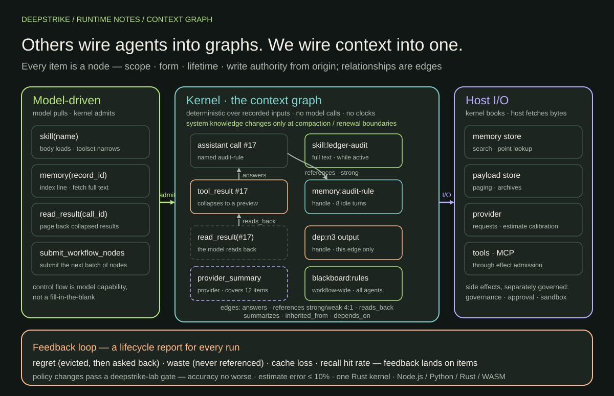
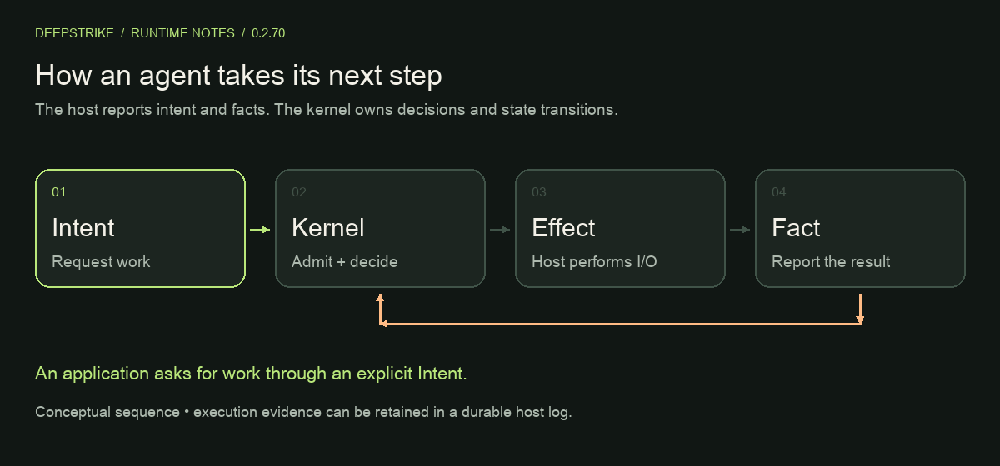

<p align="center">
  <a href="https://github.com/kongusen/deepstrike">
    
  </a>
</p>

<h1 align="center">DeepStrike</h1>

<p align="center">
  <strong>Others wire agents into graphs. DeepStrike wires context into one:<br>under a finite attention budget, deciding for every piece of information its scope, form, lifetime, and write authority.</strong>
</p>

<p align="center">
  <a href="https://github.com/kongusen/deepstrike/releases"></a>
  <a href="https://www.npmjs.com/package/@deepstrike/sdk"></a>
  <a href="https://pypi.org/project/deepstrike/"></a>
  <a href="https://crates.io/crates/deepstrike-sdk"></a>
  <a href="https://discord.gg/cwS3RBYCv"></a>
  <a href="./LICENSE"></a>
</p>

<p align="center">
  <strong>English</strong>
  · <a href="./README.zh-CN.md">中文</a>
  · <a href="./docs/en/index.md">Documentation</a>
  · <a href="https://discord.gg/cwS3RBYCv">Discord</a>
</p>

---

DeepStrike helps developers build AI assistants that carry real work over long tasks: gathering information, using tools, remembering project context, dividing work between assistants, and waiting for approval when needed.

While most frameworks polish the orchestration topology *between* agents, DeepStrike answers the question underneath: **how does the model's attention get spent?**

## The industry is building agent graphs. The bottleneck isn't the graph.

The industry's default answer is the agent graph: agents wired into DAGs, pipelines, and supervisors, with tasks flowing along the edges. But wire agents together as elegantly as you like — if what each one sees at turn 40 is wrong, the task still fails:

- memory injected in full on turn 1, then left behind as the task drifted;
- a skill body squatting in the window long after the task needed it;
- tool results stacking up until something overflows and gets truncated arbitrarily;
- ten parallel nodes inlining their full outputs, so the downstream node's first call grows with its fan-in;
- one mid-task knowledge insert invalidating the entire cached conversation prefix behind it.

What a model can see each turn is finite. Memory, skills, tool results, dependency outputs, summaries — they all compete for the same **attention budget**. Orchestration topology decides who works next; the attention budget decides what the worker can see now. Most frameworks treat context as a **log**: append, append, append, truncate when full.

Before building this mechanism we audited our own framework against its code, and grouped what we found into five failures:

| Failure | What we verified in the code |
| --- | --- |
| **No first-class lifecycle** | Memory prefetch logic was written once per SDK runner (~15k lines combined); recall, skills, dependency outputs and tool results each took their own path — no single answer to "where does it live, how long, in what form" |
| **The cache lied** | Knowledge rendered ahead of the turns, so one mid-run append invalidated the whole cached history behind it — a code comment even called this "the cheap direction"; delegate compaction to the provider, and the context the model saw was no longer the one the kernel budgeted against |
| **Relevance by word overlap** | Common words tied any note to any conversation: unrelated content never counted as waste, and worth-keeping content got evicted |
| **Orchestration unconstrained by context** | DAG edges were string concatenation cut at character counts; plan/implement sub-agents inherited the parent transcript by default; three parallel paths existed for dynamic orchestration |
| **No feedback** | Evict a piece of knowledge and never learn whether that was wrong; inject a memory and never learn it was wasted; nobody accounted for cache lost mid-run |

## Our answer: context itself is a graph

> **Under a finite attention budget, decide for every piece of information its scope (who may see it), its form (full text, a summary, or a one-line handle), its lifetime (how long it lives and which event ends it), and its write authority (who may change or remove it) — and let results correct those decisions.**

Every piece of information that enters the model's attention is a **node**; every relationship between pieces is an **edge**. The DeepStrike kernel is the bookkeeper of this graph: a deterministic state machine over recorded inputs — it never calls a model, never reads a clock, and after a crash replays to the same graph from its journal and checkpoints.

### Nodes: one context object, origin is the contract

There is only one kind of thing in context: an item. Memory index lines, skill bodies, host reference material, tool results, dependency outputs, orchestration shared state, provider summaries — all the same object. Its five attributes are not set ad hoc by callers; they are looked up from one table by **origin**. Origin is the contract.

| Origin | Scope | Form | Lifetime | Write authority |
| --- | --- | --- | --- | --- |
| System identity | this operation | full | permanent | kernel |
| Memory index line `memory:<id>` | this session | handle | 8 turns without a reference | host |
| Skill body `skill:<name>` | this task | full | until the skill deactivates — pinned or not | model |
| Host reference | this operation | full | permanent (pinnable) | host |
| Orchestration state `blackboard:<key>` | this workflow | full | permanent (phase-scoped entries leave with their phase) | host |
| Tool result | this task | full, collapsible/pageable | governed by the compression pipeline | host |
| Dependency output | this edge only | handle | permanent | kernel |
| Provider summary | this operation | full | permanent | provider |
| Note `note` (since 0.2.82) | this task | full | until the model retires it; never compacted | model |

So: a recalled memory line lives eight turns from its last reference; a skill body leaves when the skill is deactivated — a host trying to remove it mid-activation is refused outright; a dependency output belongs to its downstream node alone; a provider summary can only be written by the provider; a note is written, rewritten and retired only by the model, and no compaction tier touches it.

### Edges: every relationship recorded

The value of a graph is in its edges. The kernel draws them only from recorded inputs, so a replay always reproduces the same graph:

- **answers** — which tool result answered which call;
- **references** — which message referenced which knowledge, graded: naming a key, passing a record id in tool arguments, or expanding explicitly is strong; bare lexical overlap is weak (retention scoring weighs them 4:1);
- **reads_back** — which read-back retrieved which collapsed or paged-out result;
- **summarizes** — which summary covers which original content;
- **inherited_from** — which parent item a child run's copy came from;
- **depends_on** — which upstream output a downstream node depends on;
- **derived_from / links_to / supersedes** — which tool results a note was written from, which notes it names, and which note it replaced.

With edges, feedback lands on specific items instead of aggregate numbers: regret points at the entry evicted and then requested back along a reference; waste points at the entry no edge ever pointed at; cache loss accounts every mid-run promotion. Every run ends with a lifecycle report, and a policy change must pass its gate on real benchmarks (`deepstrike-lab`) before it lands: paired live runs on the same tasks, where success or cost per correct answer must get significantly better and neither may get significantly worse ([DEC-13](./docs/en/decisions/013-model-led-context.md)).

### Collaboration is model-driven; the kernel admits and accounts

On this graph, collaboration is not a hard-coded pipeline. Skills are activated by the model — the body loads on activation, the toolset narrows with it, deactivation releases the space. Memory is expanded by the model — index lines stay resident, `memory(record_id=…)` fetches the full record. Collapsed results are paged back in by the model. What is worth keeping is decided by the model too: it writes its working state — a running count, what is done, a rule it learned — with the `note` tool, and proposes what should outlive the task with `propose_memory`; the kernel keeps both, refusing a write over budget rather than deleting for the model. The next batch of workflow nodes is submitted by the model (`submit_workflow_nodes`) and admitted by the kernel as a canonical DAG. Host programs (`runDynamicWorkflow`) share the same vocabulary — loops, branches, and parallelism are the program itself or the model itself. We deleted the declarative loop/classify/tournament node templates: control flow is part of the model's capability, not a fill-in-the-blank in the framework.

The kernel keeps exactly three things: **admission** (governance, quotas, edge legality), **bookkeeping** (the graph and its lifecycle report), and **constraint** (scope, form, lifetime, write authority); hosts only fetch bytes — run a search, read the payload store, make a request. Side effects are governed by a separate effect-admission line (approvals, sandboxing, quotas). Shared state between a program and its agents is not closure variables pasted into prompts either: `ctx.blackboard` writes nodes on the graph (`blackboard:<key>`) that every agent spawned afterwards starts with, whatever its inheritance setting.

**The kernel never initiates a model call to manage context** ([DEC-13](./docs/en/decisions/013-model-led-context.md)). It does not ask a model to summarize, judge, rank or consolidate context on its behalf; the model is reached only as a turn of the run. In 0.2.82 every mechanism that had the kernel judge what content means — by rule or by a call of its own — was measured and deleted; the one that let the model decide was kept and turned on by default.

### Boundaries and the cache invariant

The system knowledge block renders ahead of the turns; change one byte of it and the whole cached conversation behind it is invalidated. So the kernel rewrites it only at two kinds of **boundary** (compaction, renewal); every other change — expiry, removal, same-key update — is merely marked and lands at the next boundary. Knowledge arriving mid-run stages in the state turn, at a counted cache cost. Compaction itself escalates through tiers (truncate → collapse tool results → archive by utility → summarize → renew), and re-anchors the cache only when a pass actually breaks the prefix.

### Progressive loading everywhere

| Content | Resident form | Expanded on demand |
| --- | --- | --- |
| Memory | one index line `[MEMORY record_id=… kind=… trust=…] description` | `memory(record_id=…)` point lookup of the full record |
| Dependency output | a 600-character preview | `read_result("dep:<node>")`, answered by the kernel itself |
| Tool result | collapsed to a preview under pressure, or paged out | `read_result(call_id)` pages it back in |
| Skill | catalog metadata only | the body loads on activation, and the toolset narrows with it |

Every expansion path is limited to content the caller already holds an address for — it can never become a general-purpose read primitive.

### One truth about what the model sees

- The provider compacted or cleared context server-side? The kernel absorbs it as a fact: covered history becomes a `provider_summary` item, cleared tool results degrade to handles — pressure, utility and renewal now reason over exactly what the model sees.
- Reasoning replay is held by the kernel alongside its item: after narration collapse, compaction, or renewal, it still renders back, verbatim.
- Token estimates are calibrated per request against the provider's own counts — raised, never lowered.

## Measured results

### 0.2.82: model-led notes and memory

Paired live runs on DeepSeek `deepseek-flash`, the same tasks with and without the mechanism; cost is price-weighted per correct answer, and **bold** marks a significant difference (bootstrap 95% CI).

| Scenario | Without | With | Cost per correct answer |
| --- | --- | --- | --- |
| long-horizon (30 pairs): a running tally across many files and compactions | 15/30 | **20/30** with notes | **−43%** [−62%, −19%] |
| ledger (30 pairs) | 25/30 | **30/30** with notes | −3% |
| multi-session (48 pairs): a lesson learned in one session needed in the next | 9/48 (no memory) | **33/48** with notes + `propose_memory` | **−68%** |

Mechanisms measured on the same benchmarks and deleted, because they made nothing significantly better or made something worse: compaction driven by a cache-cost account (8.3), kernel-requested model summaries at compaction (long-horizon 12/30 → 4/30, cost ×5), compaction reading notes (cost +31%), note diagnostics, and a post-session consolidation run (33/48 → 33/48, cost +272%). Fixing two provider bugs mattered more than any of them: DeepSeek tool-call markup leaking as text ended 21 of 90 runs, and repeated Ollama call ids ended 11 of 14. The full record is in [DEC-13](./docs/en/decisions/013-model-led-context.md) and the [plan](./docs/en/plans/context-lifecycle-first.md).

### Earlier: handle-shaped edges and calibrated estimates

From the lab and two live-model benchmarks (DeepSeek `deepseek-flash`):

| Metric | Before | After |
| --- | --- | --- |
| fan-out → synthesis, downstream first call | 48.5k chars | **4.5k chars (−91%)**, full text still readable via `read_result` |
| Answer accuracy (24 questions) | 24/24 | 24/24 (no regression) |
| Kernel estimate vs provider-reported tokens (size-weighted) | 11.6% | **0.7%** |

The first row compares before handle-shaped dependency edges; the other two compare before per-request estimate calibration and replay-counted pressure, on the same benchmark. All gates (accuracy no worse, weighted estimate error ≤ 10%) passed; the harness and results live in `benchmark/context-lifecycle/`.

## DeepStrike at a glance

The model's attention is a budget; context is a graph: the model pulls on demand, the kernel admits and accounts, the host only fetches bytes, and feedback lands on items along edges.



How work moves forward: Intent enters the Kernel, the Host executes admitted Effects, and returned Facts drive the next kernel transition — policy in the kernel, I/O in the host.



## What can you build?

| Application | A task you could give it | How DeepStrike helps |
| --- | --- | --- |
| **Research assistant** | “Compare these three vendors and prepare a recommendation.” | Connect search and document tools, divide the research, review the findings, and assemble a report with source references. |
| **Project knowledge assistant** | “Continue our proposal using the requirements we agreed on last time.” | Connect project documents and persistent memory so relevant information can be retrieved across tasks. |
| **Development assistant** | “Investigate this bug, propose a fix, and run the checks.” | Connect repository and development tools, isolate delegated work, and control which actions need approval. |
| **Business workflow assistant** | “Group these customer issues, draft replies, and wait for approval before sending.” | Connect your business APIs, pass work between steps, and pause at approval points. |
| **Recurring reporting assistant** | “Prepare a briefing from the latest project updates.” | Let your application trigger the task on a schedule, gather information through connected tools, and retain records for follow-up. |

These are applications you can build with the framework. Search, email, databases, scheduling, and other external services are supplied by your application through tools, MCP integrations, or custom adapters.

## Example: an assistant with a tool

Install the Node.js SDK and choose a model available to your account:

```bash
npm install @deepstrike/sdk
export OPENAI_API_KEY="your-api-key"
export OPENAI_MODEL="your-model-id"
```

Save this as `main.ts`, then run `npx tsx main.ts`:

```ts
import {
  createAgent,
  OpenAIResponsesProvider,
  tool,
} from "@deepstrike/sdk"

const apiKey = process.env.OPENAI_API_KEY
const model = process.env.OPENAI_MODEL
if (!apiKey || !model) throw new Error("Set OPENAI_API_KEY and OPENAI_MODEL")

const add = tool("add", "Add two numbers.", {
  type: "object",
  properties: { x: { type: "number" }, y: { type: "number" } },
  required: ["x", "y"],
}, async ({ x, y }) => String(Number(x) + Number(y)))

const agent = createAgent({
  name: "math",
  model: `openai/${model}`,
  runtimeBinding: { provider: new OpenAIResponsesProvider(apiKey, model) },
  tools: [add],
})

const result = await agent.run("What is 17 + 28?")
console.log(result.output)
```

The Agent facade provides in-memory sessions by default. Configure a durable session store when recovery must survive process restarts; retain the payloads and other host data your tools and integrations require. To explore without provider credentials, use the examples' `--dry-run` mode; the [example curriculum](./example/README.md) builds from sourced Q&A to a multi-assistant editorial workflow in eight runnable levels.

## What the framework takes care of

- **Tools and integrations.** Files, services, and MCP servers behind a controlled execution boundary; side effects constrained by a separate admission line (governance, approval, sandbox, quotas).
- **Reusable expertise.** Skill catalogs stay resident, bodies load on activation, the toolset narrows with them, and deactivation releases the space.
- **Project memory.** Kernel-issued recall and re-recall, index lines first with on-demand expansion; the model proposes what to keep with `propose_memory`, and writes go through an attested candidate ledger that rejects duplicates and unauthorized writes.
- **Teamwork.** Model-driven collaboration with kernel admission: dynamic workflows, handle-shaped dependency edges, a blackboard that is itself a graph node — orchestration no longer blows up the context it runs on.
- **Longer tasks.** Notes the model writes and the kernel keeps through every compaction (on by default, 600 tokens; `notesBudgetTokens: 0` turns them off); item-level compression tiers, tool-result collapse and paging, renewal at the threshold — with the cache prefix defended throughout.
- **Control.** Permissions, budgets, deadlines, approval points, and cancellation rules.
- **Recovery and inspection.** Deterministic replay from journal + checkpoints; a lifecycle report that records, item by item, what was injected, referenced, and why it left.

Start with one assistant and a few tools, then add the mechanisms your application needs. Model and integration availability varies by SDK. SDKs: [Node.js](./node/README.md) · [Python](./python/README.md) · [Rust](./rust/README.md) · [WASM](./wasm/README.md).

## What to plan for

DeepStrike is a framework you integrate into an application. You provide model access, external services, storage, and application-specific rules. Persistent memory and recovery require persistent stores; convenience APIs use in-memory defaults.

The task scheduler runs locally. Connecting remote tools does not provide a distributed worker system. Actions that affect an external system may be retried, so integrations should prevent duplicate side effects where necessary.

**Upgrading:** DeepStrike makes breaking changes within minor versions. Upgrade the kernel and SDK bindings together, and finish or abandon in-flight operations first — journals and checkpoints written by earlier versions are not guaranteed to restore. Per-version migration notes live in [MIGRATION-*.md](./MIGRATION-0.2.77-to-0.2.78.md); see [CHANGELOG.md](./CHANGELOG.md) for the full history.

## Go deeper

| Goal | Guide |
| --- | --- |
| Build a sequence of tasks | [Workflows](./docs/en/guides/workflow.md) |
| Connect tools and services | [Tools and execution](./docs/en/guides/execution-plane-and-tools.md) |
| Add reusable expertise and project memory | [Skills](./docs/en/guides/skills.md) · [Memory](./docs/en/guides/memory.md) |
| Control what assistants may do | [Governance](./docs/en/guides/governance.md) |
| Recover and inspect work | [Session and recovery](./docs/en/guides/session-replay-and-recovery.md) |
| Understand the architecture and its vocabulary | [Runtime Language](./docs/en/architecture/runtime-language.md) |
| Why context is model-led, and how a mechanism earns its place | [DEC-13: Model-Led Context](./docs/en/decisions/013-model-led-context.md) |
| Contribute to the project | [Contributing](./CONTRIBUTING.md) · [API reference](./docs/en/reference/index.md) · [Security](./SECURITY.md) |

## License

DeepStrike is dual-licensed: free under MIT-style terms for individuals and organizations with annual revenue below USD 1,000,000; organizations at or above that threshold must obtain a commercial license from the author — see [LICENSE](./LICENSE) and [COMMERCIAL.md](./COMMERCIAL.md). Versions up to and including v0.2.62 remain available under the MIT License. It is an independent project and is not affiliated with or endorsed by any model provider.
