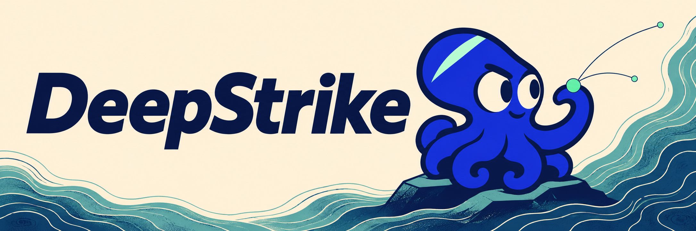
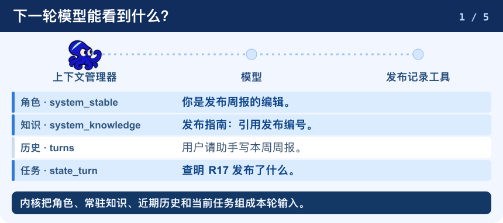
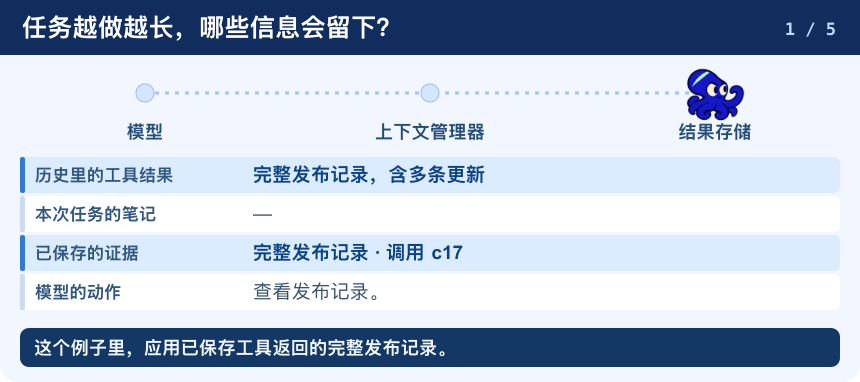
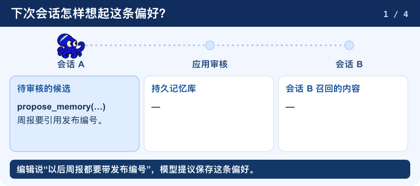
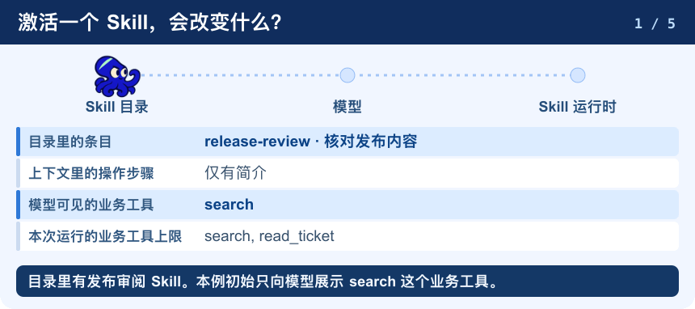

# DeepStrike

[English](./README.md) · [运行第一个助手](#运行第一个助手) · [完整示例](./example/README.md) · [中文文档](./docs/index.md) · [Discord](https://discord.gg/cwS3RBYCv)



<p align="center">
  <a href="https://github.com/kongusen/deepstrike/releases"></a>
  <a href="https://www.npmjs.com/package/@deepstrike/sdk"></a>
  <a href="https://pypi.org/project/deepstrike/"></a>
  <a href="https://crates.io/crates/deepstrike-sdk"></a>
  <a href="https://discord.gg/cwS3RBYCv"></a>
  <a href="./LICENSE"></a>
</p>

DeepStrike 是一套用来开发 AI 助手的 SDK。你接入模型和工具，**DeepStrike 负责组织模型每一步能看到的信息，以及这一步可以调用的工具**。模型可以把查证过的事实写进本次任务的笔记，把值得下次记住的偏好提请保存，也可以在遇到专门工作时加载一个 Skill。

## 一份周报是怎么写出来的

假设助手每周要读发布记录和工单，给编辑写一份周报。跟着蓝色小章鱼看四件事：它怎样查到事实、怎样在资料变多时保住进度、下周怎样想起编辑的偏好，以及怎样学会按团队的步骤审阅工单。

### 1. 工具跑完后，模型下一轮能看到什么？

用户问“R17 发布了什么？”。第一轮，模型知道任务，还缺发布记录，于是调用工具。第二轮，DeepStrike 把**工具调用和对应的结果成对交给模型**，它就有证据回答“离线搜索”。每次调用模型，内核都会把角色指令、常驻知识、近期对话和当前任务状态分开组织。图里可以看到，前两栏保持稳定，历史栏随工作推进而变化。



[一次任务的执行过程](./docs/architecture/execution-model.md) · [上下文如何组装](./docs/guides/context-engineering.md)

### 2. 记录很长，怎样记住结论，还能回头核对？

模型从发布记录里查到“R17 在 5 月 8 日发布”，调用 `note` 写进**本次任务的笔记**。当模型的输入空间吃紧，内核可以缩短较早的工具输出，继续保留这条笔记。图中的应用保存了完整记录，所以模型需要核对措辞时，还能用 `read_result(call_id="c17")` 取回原文。



[上下文管理指南](./docs/guides/context-engineering.md) · [任务笔记的设计](./docs/decisions/013-model-led-context.md)

### 3. 下周开新会话，怎样想起编辑的偏好？

编辑说“以后的周报都要带发布编号”。应用接入记忆库并开启候选写入后，模型可以调用 `propose_memory` 提议保存。**哪些候选能成为长期记忆，由应用审核决定。** 下周，同一记忆范围内的新会话可以先召回一条简短索引，知道有一条“周报偏好”。写到周报时，再用 `memory(record_id="m17")` 展开具体要求。



[记忆接入指南](./docs/guides/memory.md) · [可运行的记忆示例](./example/02-memory-assistant/)

### 4. 做到审阅这一步，怎样加载团队的工作方法？

把“先读工单，再核对发布编号”写进 `release-review` Skill。模型起初只看到 Skill 的名称和简介，需要审阅时才调用 `skill(name="release-review")` 读取正文。图中，应用把初始业务工具设为 `search`，并允许本次运行使用 `read_ticket`。**激活 Skill 后，模型既能看到审阅步骤，也能调用它声明的 `read_ticket`。** 租约到期后，业务工具列表回到 `search`。



[Skill 文件、工具和租约](./docs/guides/skills.md)

## 适合用在哪些场景

- **研究和文档审阅。** 一次读很多份材料，把结论记在任务笔记里，引用关键数字时按需读回证据。[带来源的问答示例](./example/01-sourced-qa/)
- **长期跟进同一项目或客户。** 用长期记忆保存经审核的偏好，让下次会话能找回约定。[记忆助手示例](./example/02-memory-assistant/)
- **需要遵循团队步骤的助手。** 将审阅、排查或编辑流程写成 Skill，让模型做到这一步再加载说明和相关工具。[Skill 指南](./docs/guides/skills.md)
- **多人分工或需要审批的简报。** 发布记录和工单可以并行查，汇总后再让编辑决定是否发送。[并行简报示例](./example/07-brief-pipeline/) · [审批示例](./example/05-governed-studio/) · [定期简报与恢复](./example/06-daily-digest/)

## 运行第一个助手

下面的 Node.js 示例给模型一个工具，用来读取一条示例发布记录。先安装 SDK，在环境中设置 **OPENAI_API_KEY** 和 **OPENAI_MODEL**，选择你的账号可用、支持工具调用的 OpenAI Chat Completions 模型。

```sh
npm install @deepstrike/sdk
```

将下面的代码保存为 `brief.mjs`，执行 `node brief.mjs`。

```js
import { createAgent, OpenAIProvider, tool } from "@deepstrike/sdk";

const { OPENAI_API_KEY: apiKey, OPENAI_MODEL: model } = process.env;
if (!apiKey || !model) throw new Error("Set OPENAI_API_KEY and OPENAI_MODEL");

const readRelease = tool(
  "read_release", "Read the team's latest release note.",
  { type: "object", properties: {}, required: [] },
  async () => "R17 shipped on May 8. Offline search is now available."
);

const editor = createAgent({
  name: "brief-editor",
  model: `openai/${model}`,
  runtimeBinding: { provider: new OpenAIProvider({ apiKey, model }) },
  tools: [readRelease],
});

const result = await editor.run("请调用 read_release，用中文回答：发布了什么功能，哪一天发布？");
console.log(result.output);
```

回答中应该能看到发布日期 **5 月 8 日**和新功能**离线搜索**。把返回示例文本的函数替换成查询工单或文档库的代码，就接上了自己的数据。

**选择 SDK** · [Node.js](./node/README.md) · [Python](./python/README.md) · [Rust](./rust/README.md) · [浏览器和边缘环境（WASM）](./wasm/README.md)

要了解实现，可以看[一次任务的执行过程](./docs/architecture/execution-model.md)、[上下文设计决策](./docs/decisions/013-model-led-context.md)和[基准测试](./benchmark/context-lifecycle/)。版本变化和参与方式见[更新日志](./CHANGELOG.md)和[贡献指南](./CONTRIBUTING.md)。

## 许可证

DeepStrike 采用双授权：个人及上一财年总营收低于 100 万美元的组织可按 MIT 条款免费使用；达到或超过该阈值的组织须联系作者获取商业授权——详见 [LICENSE](./LICENSE) 与 [COMMERCIAL.md](./COMMERCIAL.md)。v0.2.62 及之前的版本继续适用 MIT 协议。这是一个独立项目，不隶属于任何模型提供商，也未获得任何模型提供商背书。
