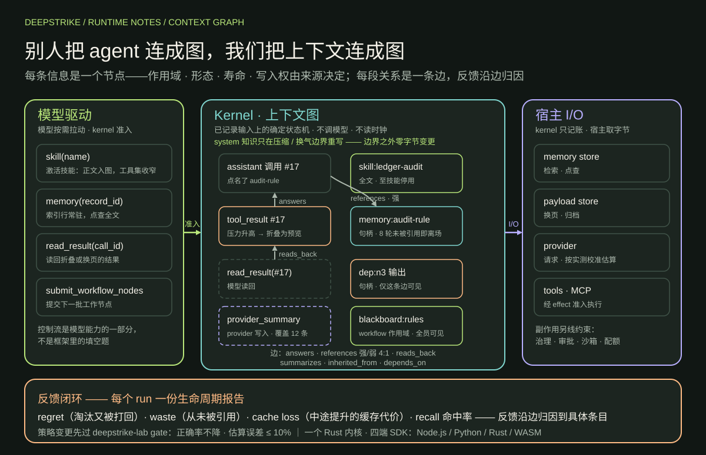
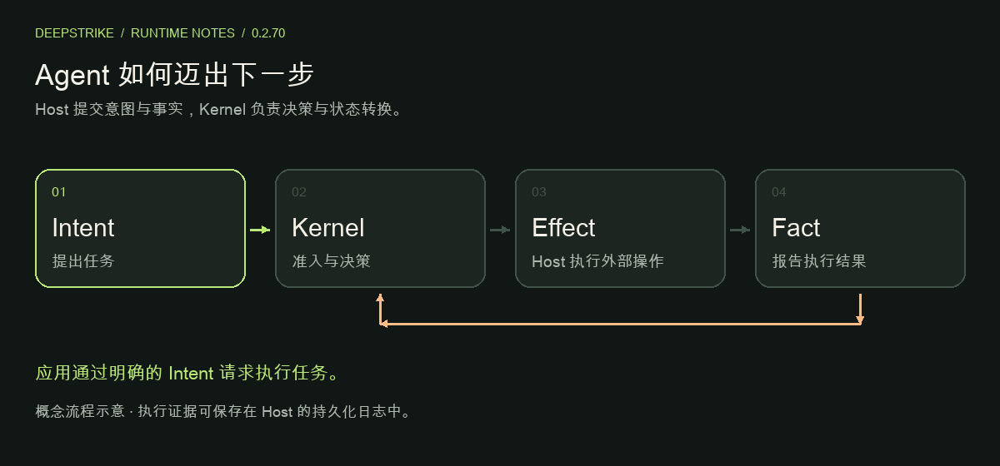

<p align="center">
  <a href="https://github.com/kongusen/deepstrike">
    
  </a>
</p>

<h1 align="center">DeepStrike</h1>

<p align="center">
  <strong>别人把 agent 连成图，DeepStrike 把上下文连成图：<br>在有限的注意力预算下，为每一条信息决定作用域、形态、寿命和写入权。</strong>
</p>

<p align="center">
  <a href="https://github.com/kongusen/deepstrike/releases"></a>
  <a href="https://www.npmjs.com/package/@deepstrike/sdk"></a>
  <a href="https://pypi.org/project/deepstrike/"></a>
  <a href="https://crates.io/crates/deepstrike-sdk"></a>
  <a href="https://discord.gg/cwS3RBYCv"></a>
  <a href="./LICENSE"></a>
</p>

<p align="center">
  <strong>中文</strong>
  · <a href="./README.md">English</a>
  · <a href="./docs/index.md">文档</a>
  · <a href="https://discord.gg/cwS3RBYCv">Discord</a>
</p>

---

DeepStrike 帮开发者搭建能完成真实长任务的 AI 助手：查资料、用工具、记住项目背景、多助手分工、需要时等审批。

当大多数框架在打磨 agent 之间的编排拓扑时，DeepStrike 回答的是更底层的问题：**模型的注意力怎么花。**

## 别人在做 agent 图，瓶颈却不在图上

行业的默认答案是 agent graph：把 agent 连成 DAG、pipeline、supervisor，让任务沿边流动。但把 agent 连得再漂亮，如果每个 agent 在第 40 轮看见的东西已经不对了，任务照样失败：

- 记忆在第 1 轮全文注入，之后任务漂移了也无人过问；
- 技能正文加载后一直占着窗口，任务早就不需要它了；
- 工具结果一层层堆高，直到溢出，被任意截断；
- 十个并行节点的输出全文内联，下游第一个调用的上下文随扇入宽度线性膨胀；
- 任务中途注入一条知识，身后整段已缓存的对话前缀全部作废。

模型每一轮能“看见”的内容是有限的。记忆、技能、工具结果、依赖输出、摘要——都在竞争同一份**注意力预算**。编排拓扑决定“谁接着谁做”，注意力预算决定“做事的人此刻看得见什么”。多数框架把上下文当**日志**用：追加、追加、追加，满了截断。

构建这套机制之前，我们对照代码逐条审计了自己的框架，把发现的问题归为五类：

| 问题 | 我们在代码里核实到的 |
| --- | --- |
| **生命周期没有一等对象** | 记忆预取逻辑在四个 SDK 的 runner 里各写一遍（合计约 1.5 万行）；recall、skill、依赖输出、工具结果各走各的路径——“放哪、留多久、什么形态”没有统一答案 |
| **缓存在说谎** | 知识块渲染在对话轮之前，运行中追加一条就让身后整段已缓存 history 作废，代码注释还称之为 "cheap direction"；把压缩下放给 provider 后，模型实际看到的上下文和 kernel 用来计算压力的又不是同一份 |
| **相关性只靠词法重叠** | 常见词能把任何笔记“关联”到任何对话：无关内容不计入浪费，该留的反被误杀 |
| **编排不受上下文约束** | DAG 边靠字符串拼接、按字符截断；plan/implement 子 agent 默认继承父对话全文；动态编排同时存在三条并行路径 |
| **没有反馈** | 淘汰一条知识，不知道淘汰错了没有；注入一条记忆，不知道白费了没有；缓存损失了多少 token，无人记账 |

## 我们的答案：上下文本身是一张图

> **在有限的注意力预算下，为每一条信息决定它的作用域（谁能看见它）、形态（以全文、摘要还是一行句柄呈现）、寿命（活到什么时候、由什么事件终结）和写入权（谁能改它、谁能删它），并让这些决定能被结果修正。**

每一条进入模型注意力的信息是一个**节点**，信息之间的关系是一条**边**。DeepStrike 的 kernel 是这张图的记账人：一个已记录输入上的确定状态机——不调模型、不读时钟，崩溃后靠 journal 与 checkpoint 重放出同一张图。

### 节点：一种内容对象，来源即契约

上下文里只有一种东西：item。记忆索引行、技能正文、宿主资料、工具结果、依赖输出、编排共享状态、provider 摘要，全是同一种对象。它的五个属性不由调用方随手指定，而是由**来源**从一张表里查出来：来源即契约。

| 来源 | 作用域 | 形态 | 寿命 | 写入权 |
| --- | --- | --- | --- | --- |
| 系统身份 | 本 operation | 全文 | 永久 | kernel |
| 记忆索引行 `memory:<id>` | 本 session | 句柄 | 8 轮未被引用即离场 | host |
| 技能正文 `skill:<name>` | 本 task | 全文 | 直到技能停用——钉住也一样 | model |
| 宿主资料 | 本 operation | 全文 | 永久（可 pin） | host |
| 编排共享状态 `blackboard:<key>` | 本 workflow | 全文 | 永久（phase 级条目随 phase 结束） | host |
| 工具结果 | 本 task | 全文，可折叠/换页 | 随压缩管线 | host |
| 依赖输出 | 仅这条边 | 句柄 | 永久 | kernel |
| provider 摘要 | 本 operation | 全文 | 永久 | provider |
| 笔记 `note`（0.2.82 起） | 本 task | 全文 | 直到模型撤下；永不被压缩 | model |

于是：一行记忆索引从最近一次被引用起只活 8 轮；一条技能正文随技能停用离开，宿主想在激活期间删它会被整条拒绝；一条依赖输出只属于它的下游节点；一条 provider 摘要只有 provider 能改；一条笔记只有模型能写、能改、能撤，任何压缩层都不碰它。

### 边：每一段关系都被记录

图的价值在边上。kernel 只依据已记录的输入建边，所以重放永远得到同一张图：

- **answers** —— 哪个工具结果回答了哪次调用；
- **references** —— 哪条消息引用了哪份知识，且分强弱：点名 key、在工具参数里传记录 id、显式展开是强引用，纯词法重叠只算弱引用（留任打分 4:1）；
- **reads_back** —— 哪次读回取回了哪个被折叠或换页的结果；
- **summarizes** —— 哪个摘要覆盖了哪些原始内容；
- **inherited_from** —— 子 run 继承的副本来自父 run 的哪一条；
- **depends_on** —— 下游节点依赖哪个上游节点的输出；
- **derived_from / links_to / supersedes** —— 一条笔记依据哪些工具结果写成、提到了哪些笔记、替换了哪条笔记。

有了边，反馈能落到具体条目上，而不是一堆汇总数字：regret 指向被淘汰后又被引用要回的那条，waste 指向入图以来没有任何引用指向它的那条，cache loss 记账每一次中途提升花掉的缓存。每个 run 结束输出生命周期报告；策略变更要在真实基准上过 lab 的 gate，不过不合入：同一批题逐题配对实测，正确率或“每答对一题的成本”至少一项显著变好，且两项都不显著变差（[DEC-13](./docs/decisions/013-model-led-context.md)）。

### 协作由模型驱动，kernel 只做准入与记账

在这张图上，协作不靠硬编码管道。技能由模型激活——正文才载入，工具集随之收窄，停用即离场；记忆由模型展开——索引行常驻，`memory(record_id=…)` 点查全文；被折叠的结果由模型读回；什么值得留下也由模型决定——它用 `note` 工具写下工作状态（一条累计计数、做完了什么、学到的一条规则），用 `propose_memory` 提交值得跨任务保留的内容，kernel 负责留住，预算超了就拒绝写入，而不是替模型删；下一批工作节点由模型提交（`submit_workflow_nodes`），由 kernel 准入为 canonical DAG。宿主程序（`runDynamicWorkflow`）与模型共享同一套词汇——循环、分支、并行就是程序本身或模型本身。声明式的 loop/classify/tournament 节点模板我们删掉了：控制流本就是模型能力的一部分，不该是框架里的填空题。

kernel 保留的只有三样：**准入**（治理、配额、边合法性）、**记账**（图与生命周期报告）、**约束**（作用域、形态、寿命、写入权）；宿主只负责取回正文——跑一次检索、读一次 payload store、发一次请求。副作用另由 effect 准入线约束（审批、沙箱、配额）。程序与 agent 之间的共享状态也不靠闭包变量拼 prompt：`ctx.blackboard` 写的就是图上的节点（`blackboard:<key>`），此后派生的每个 agent 无论继承设置如何都能拿到。

**kernel 不为管理上下文发起模型调用**（[DEC-13](./docs/decisions/013-model-led-context.md)）。它不请模型替它摘要、评判、排序或整理上下文；模型只作为 run 的一轮被调用。0.2.82 里，凡是让 kernel 按规则或靠自己发起的调用去判断内容意义的机制，实测之后都删了；让模型自己决定的那一项留了下来，并默认开启。

### 边界与缓存不变式

system 知识块渲染在对话之前，改它一个字节就让身后已缓存的整段对话作废。所以 kernel 只在两类**边界**（压缩、换气 renewal）重写它；其余一切变更——到期、删除、同 key 更新——都只是标记，到边界才生效。运行中途到达的知识先进 state turn，缓存代价可算；压缩本身分级递进（截断 → 工具结果折叠 → 按效用归档 → 摘要 → 换气），且只在真正破坏缓存前缀时才重锚。

### 一律渐进加载

| 内容 | 常驻形态 | 按需展开 |
| --- | --- | --- |
| 记忆 | 一行索引 `[MEMORY record_id=… kind=… trust=…] 描述` | `memory(record_id=…)` 点查全文 |
| 依赖输出 | 600 字符预览 | `read_result("dep:<node>")`，kernel 直接作答 |
| 工具结果 | 压力升高时折叠为预览、或换页出窗 | `read_result(call_id)` 换页回读 |
| 技能 | 目录里只有元数据 | 激活时才载入正文，工具集随之收窄 |

每条展开路径都被限制在“调用者已持有地址”的内容上——它永远成不了通用读原语。

### 一份真相：模型看见什么，kernel 就记账什么

- provider 在服务端压缩、清理了上下文？kernel 把它作为 fact 吸收：被覆盖的历史变成一个 `provider_summary` item，被清理的工具结果降级为句柄——此后压力、效用、换气判据全部基于模型实际可见的内容。
- reasoning 回放由 kernel 随 item 持有：叙述被折叠、压缩、换气之后，依然原样渲染回去。
- token 估算按 provider 实测逐请求校准，只抬高不压低。

## 实测结果

### 0.2.82：模型主导的笔记与记忆

在 DeepSeek `deepseek-flash` 上实测，同一批题开/关该机制逐题配对；成本按价格加权、按每答对一题计算，**加粗**表示差异显著（bootstrap 95% 置信区间）。

| 场景 | 不开 | 开启 | 每答对一题的成本 |
| --- | --- | --- | --- |
| long-horizon（30 对）：跨多个文件、多次压缩维持一个累计计数 | 15/30 | **20/30**（笔记） | **−43%** [−62%, −19%] |
| ledger（30 对） | 25/30 | **30/30**（笔记） | −3% |
| multi-session（48 对）：上一个会话学到的教训，下一个会话要用 | 9/48（无记忆） | **33/48**（笔记 + `propose_memory`） | **−68%** |

在同样的基准上实测后删除的机制（没有任何一项显著变好，或者让某项变差）：按缓存成本账决定压缩什么（8.3）、压缩时由 kernel 请模型写摘要（long-horizon 12/30 → 4/30，成本 5 倍）、压缩读取笔记（成本 +31%）、笔记诊断、会话结束后的整理 run（33/48 → 33/48，成本 +272%）。比这些都重要的是修掉两个 provider bug：DeepSeek 把工具调用标记当文本输出，终止了 90 次运行中的 21 次；Ollama 工具调用 id 重复，终止了 14 次中的 11 次。完整记录见 [DEC-13](./docs/decisions/013-model-led-context.md) 和[计划](./docs/plans/context-lifecycle-first.md)。

### 更早：句柄化依赖边与校准估算

来自 lab 与两个真实模型基准（DeepSeek `deepseek-flash`）：

| 指标 | 改造前 | 改造后 |
| --- | --- | --- |
| fan-out → 汇总，下游首个调用 | 48.5k 字符 | **4.5k 字符（−91%）**，全文仍可 `read_result` 读回 |
| 答题正确率（24 题） | 24/24 | 24/24（不降） |
| kernel 估算 vs provider 实测误差（按请求大小加权） | 11.6% | **0.7%** |

首行对比句柄化依赖边引入之前；后两行来自同一基准上引入按实测校准与 replay 计压前后。三组 gate（正确率不降、加权估算误差 ≤10%）全部通过；测量脚本与结果见 `benchmark/context-lifecycle/`。

## 一图看懂 DeepStrike

模型的注意力是预算，上下文是一张图：模型按需拉动，kernel 记账与准入，宿主只取字节，反馈沿边归因。



一次任务如何向前推进：Intent 提交给 Kernel，获准的 Effect 由 Host 执行，Fact 返回 Kernel 驱动下一次状态转换——策略在 kernel，I/O 在宿主。



## 你可以用它做什么

| 你想搭建的应用 | 可以交给它的任务 | DeepStrike 如何帮助你实现 |
| --- | --- | --- |
| **研究与资料整理助手** | “比较这三家供应商，整理差异并给出建议。” | 接入搜索和文档工具，分工调研、复核发现，再汇总成带来源的报告。 |
| **项目知识助手** | “根据上次确定的要求，继续完善这份方案。” | 接入项目文档和持久记忆，让助手在后续任务中检索相关背景。 |
| **研发协作助手** | “调查这个 bug，提出修改并运行检查。” | 接入代码仓库与开发工具，隔离委托任务，并控制哪些操作需要审批。 |
| **业务流程助手** | “归类这些客户问题，生成回复草稿，批准后再发送。” | 接入业务接口，把工作传给下一步骤，在审批节点暂停。 |
| **日报与简报助手** | “根据最新项目进展，准备一份简报。” | 由你的应用定时触发任务，通过已接入的工具收集信息，并保留后续跟进需要的记录。 |

这些是可以用框架搭建的应用。搜索、邮件、数据库、定时触发等外部能力，需要由你的应用通过工具、MCP 集成或自定义适配器接入。

## 框架替你处理哪些工作

- **接入工具。** 让助手在受控边界内使用文件、外部服务和 MCP Server；副作用由独立的 effect 准入线约束（治理、审批、沙箱、配额）。
- **按需专业技能。** Skill 目录常驻、正文激活时才载入，工具集随之收窄，停用即离场。
- **项目记忆。** kernel 发起召回与续召，索引行先行、按需展开；模型用 `propose_memory` 提交值得保留的内容，写入走带校验的候选账本，杜绝重复与越权。
- **分工协作。** 协作由模型驱动、由 kernel 准入：动态工作流、句柄化的依赖边、作为图节点的 blackboard——编排不再撑爆它所运行的上下文。
- **长任务。** 模型写、kernel 保的笔记，扛过每一次压缩（默认开启，预算 600 token；`notesBudgetTokens: 0` 关闭）；item 级压缩阶梯、工具结果折叠与换页、到阈值换气续跑，全程守住缓存前缀。
- **控制执行。** 权限、预算、时限、审批节点和取消规则。
- **恢复和检查。** journal + checkpoint 确定性重放；生命周期报告逐 item 记录注入、引用、离开与原因。

可以从一个助手和几个工具开始，按应用需要增加能力。各 SDK 支持的模型和集成范围有所不同。

## 从哪里开始

选择适合你的 SDK：[Node.js](./node/README.md) · [Python](./python/README.md) · [Rust](./rust/README.md) · [WASM](./wasm/README.md)。

第一个应用可以跟随 [Hello Agent](./docs/getting-started/hello-agent.md) 完成。想先体验流程，可以运行示例中的 `--dry-run`，无需配置 Provider 凭据。

<details>
<summary>开发者示例：带一个工具和本地执行日志的助手</summary>

安装 Node.js SDK，选择你的模型账户可用的模型。

```bash
npm install @deepstrike/sdk
export OPENAI_API_KEY="your-api-key"
export OPENAI_MODEL="your-model-id"
```

将以下代码保存为 `main.ts`，运行 `npx tsx main.ts`。

```ts
import {
  createAgent,
  OpenAIResponsesProvider,
  tool,
} from "@deepstrike/sdk"

const apiKey = process.env.OPENAI_API_KEY
const model = process.env.OPENAI_MODEL
if (!apiKey || !model) throw new Error("Set OPENAI_API_KEY and OPENAI_MODEL")

const add = tool("add", "Add two numbers.", {
  type: "object",
  properties: { x: { type: "number" }, y: { type: "number" } },
  required: ["x", "y"],
}, async ({ x, y }) => String(Number(x) + Number(y)))

const agent = createAgent({
  name: "math",
  model: `openai/${model}`,
  runtimeBinding: { provider: new OpenAIResponsesProvider(apiKey, model) },
  tools: [add],
})

const result = await agent.run("What is 17 + 28?")
console.log(result.output)
```

Agent facade 默认使用进程内 Session。需要跨进程恢复时配置持久化 Session 存储；生产环境还需要保留工具与集成所依赖的 payload 等 Host 数据。

</details>

## 使用前需要准备什么

DeepStrike 是供开发者接入应用的框架。你需要提供模型访问、外部服务、存储和具体业务规则。持久记忆与恢复需要持久化存储，便捷 API 默认使用内存。

任务调度器在本地运行，接入远程工具不等于获得分布式 worker 系统。影响外部系统的操作可能被重试，集成时应按需避免重复产生副作用。

**升级时：** DeepStrike 允许在小版本内做破坏性演进。kernel 与 SDK bindings 需要一起升级，先结束或放弃在途任务——更早版本写下的 journal 与 checkpoint 不保证可恢复。逐版本迁移说明见 [MIGRATION-*.md](./MIGRATION-0.2.77-to-0.2.78.md)，变更明细见 [CHANGELOG.md](./CHANGELOG.md)。

## 继续了解

| 你想做什么 | 文档入口 |
| --- | --- |
| 安排一组有先后关系的任务 | [Workflow](./docs/guides/workflow.md) |
| 接入工具与外部服务 | [工具与执行](./docs/guides/execution-plane-and-tools.md) |
| 添加专业指引与项目记忆 | [Skill](./docs/guides/skills.md) · [Memory](./docs/guides/memory.md) |
| 控制助手可以做什么 | [治理](./docs/guides/governance.md) |
| 恢复与检查任务 | [Session 与恢复](./docs/guides/session-replay-and-recovery.md) |
| 理解架构及其术语 | [运行时语言字典](./docs/architecture/runtime-language.md) |
| 为什么上下文由模型主导、机制凭什么留下 | [DEC-13：模型主导上下文](./docs/decisions/013-model-led-context.md) |
| 参与项目开发 | [贡献指南](./CONTRIBUTING.md) · [API 参考](./docs/reference/index.md) · [安全问题](./SECURITY.md) |

## 许可证

DeepStrike 采用双授权：个人及上一财年总营收低于 100 万美元的组织可按 MIT 条款免费使用；达到或超过该阈值的组织须联系作者获取商业授权——详见 [LICENSE](./LICENSE) 与 [COMMERCIAL.md](./COMMERCIAL.md)。v0.2.62 及之前的版本继续适用 MIT 协议。这是一个独立项目，不隶属于任何模型提供商，也未获得任何模型提供商背书。
